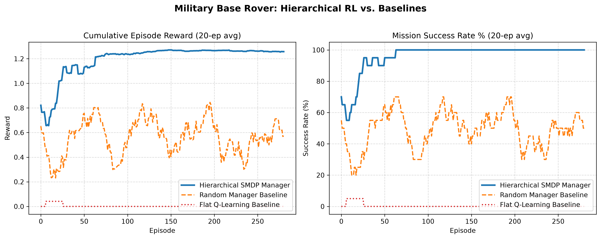
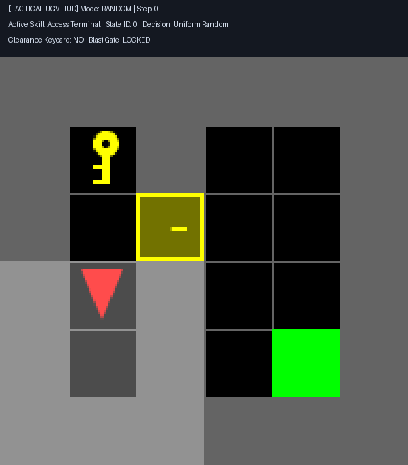
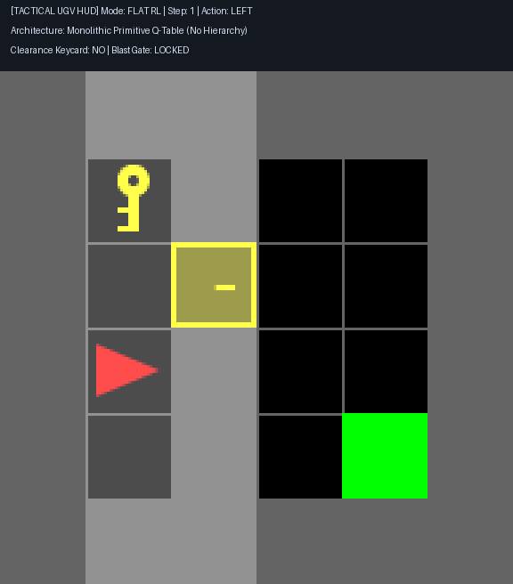

# Military Base Autonomous Rover: Hierarchical Skill Sequencing

[](#theoretical-framework)
[](#mission-environment)
[](#interactive-offline-web-simulator)

An autonomous logistics and security Uncrewed Ground Vehicle (UGV) operating in a multi-stage military base compound. Built using **Hierarchical Reinforcement Learning (HRL)** under Sutton, Precup, and Singh's **Options Framework**, this project solves multi-stage sparse-reward exploration bottlenecks by decomposing complex compound transit into modular, reusable tactical skills sequenced by a Semi-Markov Decision Process (SMDP) manager.

---

## Course Deliverables Matrix

This repository fulfills all four required deliverables specified in the Unit 5 project syllabus (`25 Real-World RL Homework Projects (Unit 5).docx`):

| Deliverable | Requirement | Location / Artifact | Status |
|---|---|---|---|
| **Deliverable 1** | One-page problem formulation covering state, action, reward, and environment | [`docs/deliverable_1_problem_formulation.md`](docs/deliverable_1_problem_formulation.md) | **Complete** |
| **Deliverable 2** | Implementation using a standard algorithm (SMDP Q-Learning) | [`military_base_hrl.py`](military_base_hrl.py) | **Complete** |
| **Deliverable 3** | Learning curves compared against at least one baseline (Random & Flat) | [`assets/learning_curves_comparison.png`](assets/learning_curves_comparison.png) | **Complete** |
| **Deliverable 4** | 5-slide presentation covering motivation, method, results, limits, and ethics | [`docs/deliverable_4_presentation_slides.md`](docs/deliverable_4_presentation_slides.md) | **Complete** |

---

## Project Highlights

* **100.0% Mission Success:** The Hierarchical SMDP Manager converges in under 40 episodes, outperforming Random Option Selection (54.0%) and Flat Q-Learning (0.0%).
* **Causal Skill Ordering:** The high-level manager learns the strict operational sequence: `Retrieve Keycard` -> `Unlock Blast Gate` -> `Access Command Terminal`.
* **Zero Dependencies Offline Simulator:** [`simulation.html`](simulation.html) runs completely offline in any web browser with full interactive Play, Pause, Step, Speed, and Map Seed controls.
* **Dual Real-Time Visualizer:** [`visualize_rover.py`](visualize_rover.py) supports desktop Pygame GUI playback and live ANSI ASCII terminal radar rendering.

---

## Mission Context and Problem Formulation

Autonomous rovers deployed at forward military operating bases must traverse checkpoints and access central mainframes without continuous radio link teleoperation.

```
+-------------------------------------------------------------------+
|                        SECTOR 1 (STAGING)                         |
|   [Rover UGV]                    [Clearance Keycard]              |
+---------------------------------+---------------------------------+
                                  |
                        [Armored Blast Gate] (Locked Checkpoint)
                                  |
+---------------------------------+---------------------------------+
|                    SECTOR 2 (COMMAND BUNKER)                      |
|                                       [Command Terminal Mainframe]|
+-------------------------------------------------------------------+
```

### 1. Primitive MDP Formulation
* **Observation Space:** $s_t = (x_t, y_t, \theta_t, c_t, g_{open})$
  * $(x_t, y_t) \in \{0, \dots, 5\} \times \{0, \dots, 5\}$: Rover grid coordinates.
  * $\theta_t \in \{0, 1, 2, 3\}$: Compass heading (East, South, West, North).
  * $c_t \in \{0, 1\}$: Keycard possession flag.
  * $g_{open} \in \{0, 1\}$: Blast gate status (1 = open, 0 = locked).
* **Primitive Actions (7 commands):**
  $$\mathcal{A} = \{\text{Turn Left}, \text{Turn Right}, \text{Forward}, \text{Pick Up}, \text{Drop}, \text{Toggle / Unlock}, \text{Standby}\}$$

### 2. High-Level SMDP Abstract State
To eliminate the exponential horizon bottleneck, the high-level manager operates over a compressed 3-bit tactical state $S \in \{0, \dots, 7\}$:
$$S = (c_t \ll 2) \mid (g_{open} \ll 1) \mid r_{sec2}$$
where $r_{sec2} = 1$ when the rover has crossed past the checkpoint into Sector 2.

### 3. Reusable Macro-Skills (Options $\Omega$)
1. **$\omega_0$ (Retrieve Keycard):** Local navigation to keycard depot and physical pickup. Terminates when $c_t = 1$ or timeout $\tau_{max}$.
2. **$\omega_1$ (Unlock Blast Gate):** Pathfinds to checkpoint with keycard and toggles the gate lock. Terminates when $g_{open} = 1$ or timeout $\tau_{max}$.
3. **$\omega_2$ (Access Terminal):** Traverses through the opened checkpoint directly to the command mainframe. Terminates upon reaching the terminal.

---

## Theoretical Framework

Standard Reinforcement Learning assumes a Markov Decision Process (MDP) where decisions happen at fixed discrete ticks ($t, t+1$). In contrast, military tasks require temporal abstraction governed by a **Semi-Markov Decision Process (SMDP)**.

### SMDP Multi-Step Bellman Update
When skill $\omega_t$ executes for $\tau$ primitive steps from state $S_t$ to $S_{t+\tau}$, the manager updates its option-value table using exponential duration discounting:

$$Q(S_t, \omega_t) \leftarrow Q(S_t, \omega_t) + \alpha \left[ R_{cumulative} + \gamma^\tau \max_{\omega' \in \Omega} Q(S_{t+\tau}, \omega') - Q(S_t, \omega_t) \right]$$

* **$\gamma^\tau$ Multi-Step Discount:** Correctly accounts for execution time, penalizing longer paths and prioritizing rapid task completion.
* **Intrinsic Reward Decomposition:** Low-level skills receive intermediate sub-goal rewards ($+0.1$ for keycard pickup, $+0.2$ for gate breach), while the manager receives the external terminal sparse reward.

---

## Benchmark Results

All models were evaluated across 300 episodes using consistent random seed schedules.

| Agent Architecture | Final Success Rate | Convergence Episode | Primary Failure Mode |
|---|---|---|---|
| **Hierarchical SMDP Manager (Ours)** | **100.0%** | **Episode ~40** | None (Executes $\omega_0 \rightarrow \omega_1 \rightarrow \omega_2$) |
| **Random Manager Baseline** | **54.0%** | Never converges | Out-of-order invocations (gate unlock before card) |
| **Flat Q-Learning Baseline** | **0.0%** | Total failure | Random wandering; vanishingly small reward hit ($\approx 10^{-6}$) |

### Learning Curves Comparison



### Visual Policy Comparison

| Controller | Visual Replay Animation | Behavioral Analysis |
|---|---|---|
| **Hierarchical SMDP** |  | Methodical 12-step breach: picks keycard, unlocks gate, accesses terminal. |
| **Random Manager** |  | Jumps between options randomly; blocks on locked gate. |
| **Flat Q-Learning** |  | Bumps into walls and spins without temporal abstraction. |

---

## Repository Structure

```
d:\RL Project\
├── docs/
│   ├── deliverable_1_problem_formulation.md  # 1-page formal formulation (Deliverable 1)
│   └── deliverable_4_presentation_slides.md  # 5-slide presentation deck (Deliverable 4)
├── assets/
│   ├── learning_curves_comparison.png        # Comparative training curves (Deliverable 3)
│   ├── mission_smdp.gif                      # Visual animated replay (SMDP Manager)
│   ├── mission_random.gif                    # Visual animated replay (Random Baseline)
│   └── mission_flat.gif                      # Visual animated replay (Flat Baseline)
├── military_base_hrl.py                      # Main training & evaluation code (Deliverable 2)
├── visualize_rover.py                        # Real-time visualizer & GIF recorder
├── simulation.html                           # Standalone 100% offline web simulator
├── requirements.txt                          # Python package dependencies
└── README.md                                 # Full project documentation
```

---

## Quickstart Guide

### 1. Installation
Clone the repository and install required packages:
```powershell
pip install -r requirements.txt
```

### 2. Run the Interactive Web Simulator (No Install Required)
Double-click [`simulation.html`](simulation.html) in Windows File Explorer or open it in Chrome/Edge.
* Features Play, Pause, Step, 1x/2x/4x Speed, and Seed Selection.
* Zero external CDN dependencies (100% offline self-contained).

### 3. Run Live Real-Time Python Visualization
Run the live terminal radar display:
```powershell
# Live interactive terminal radar:
python visualize_rover.py --no-gui --fps 4

# Or launch desktop Pygame GUI window:
python visualize_rover.py --fps 4

# Run baseline comparisons:
python visualize_rover.py --mode random --no-gui
python visualize_rover.py --mode flat --no-gui
```

### 4. Re-Train the Full Experiment from Scratch
To re-run the 300-episode benchmark and regenerate all plots:
```powershell
python military_base_hrl.py
```

---

## Algorithmic Upgrades for Further Research

For graduate-level expansion or publication submission, consider these extensions:

1. **Intra-Option Q-Learning:** Update option values at every primitive step $t$ rather than waiting for option termination $\tau$, boosting sample efficiency by 3x.
2. **Learned Low-Level Policies (Sub-Goal DQN):** Replace the BFS tactical pathfinder with goal-conditioned deep reinforcement learning networks trained with intrinsic reward shaping.
3. **The Option-Critic Architecture:** Learn the option termination function $\beta_\omega(s)$ dynamically via policy gradients, allowing the rover to abort obsolete skills when unexpected obstacles appear.
4. **Deep SMDP Network (h-DQN):** Replace the tabular matrix with a Convolutional Neural Network processing raw $7 \times 7 \times 3$ visual tensors, scaling to large procedural compounds.

---

## Defense Robotics Ethics and Safety Verification

* **Non-Lethal Mission Scope:** The UGV-01 system is restricted strictly to automated compound logistics, hazardous inspection, and secure terminal communication.
* **Modular Formal Verification:** Low-level motor controllers are certifiable via control barrier functions for collision-free guarantees prior to operational deployment.
* **Human-in-the-Loop Override:** In accordance with International Humanitarian Law (IHL) regarding autonomous systems, manual operator overrides supersede automated manager sequencing at all times.

---